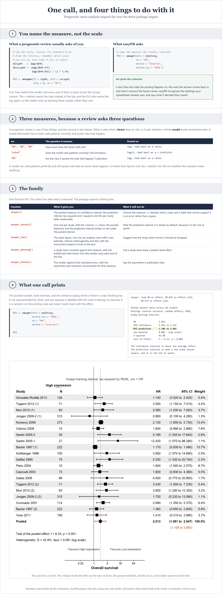
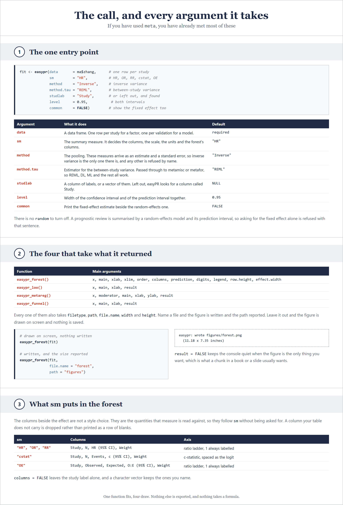
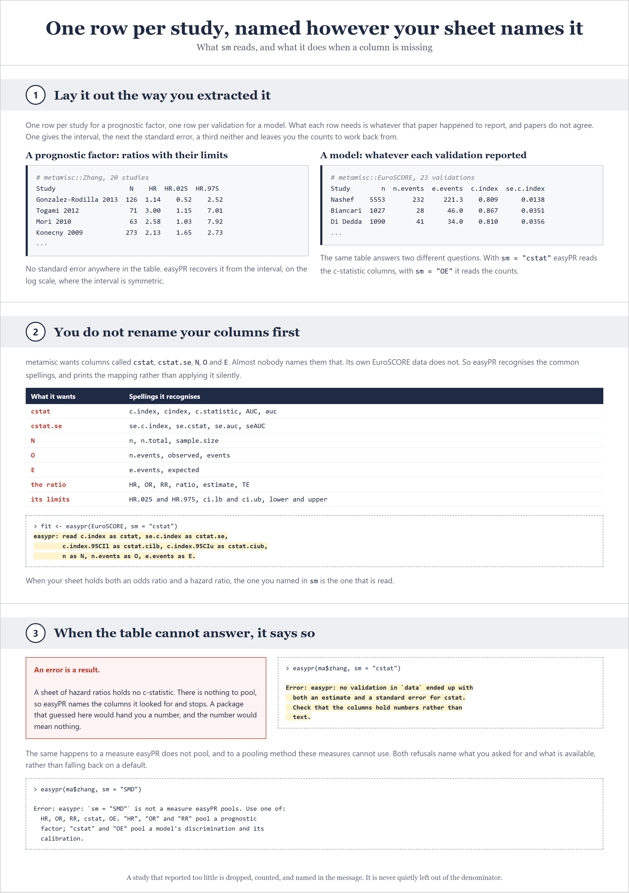
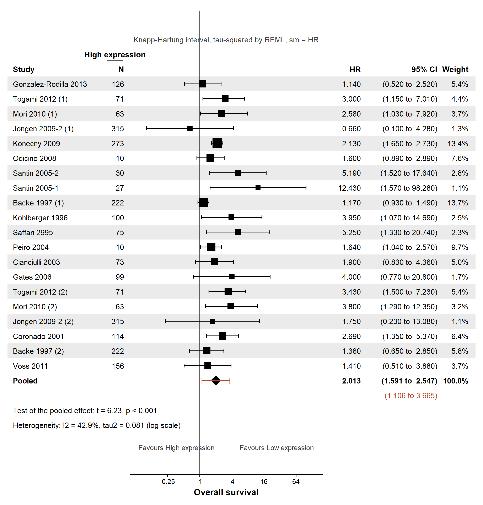
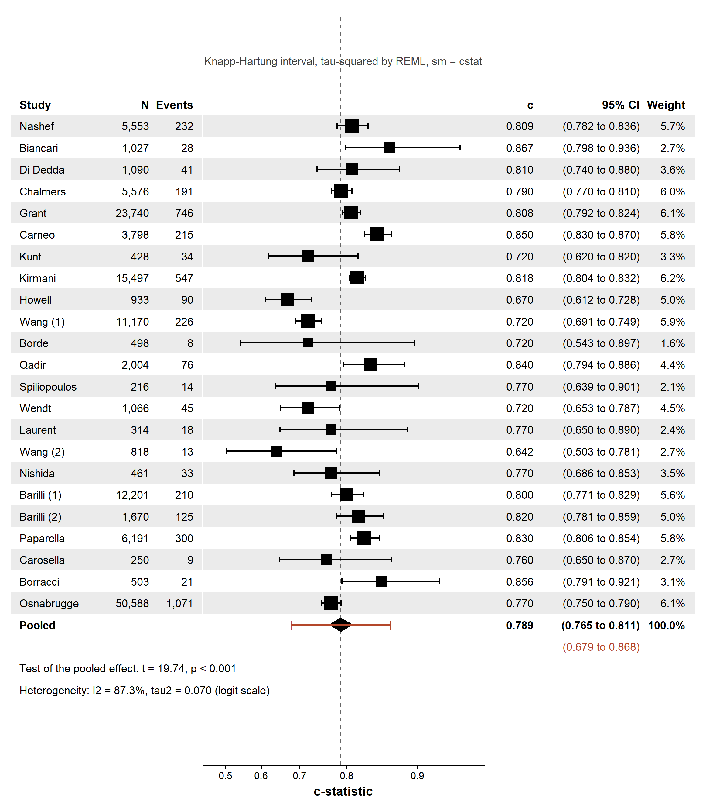
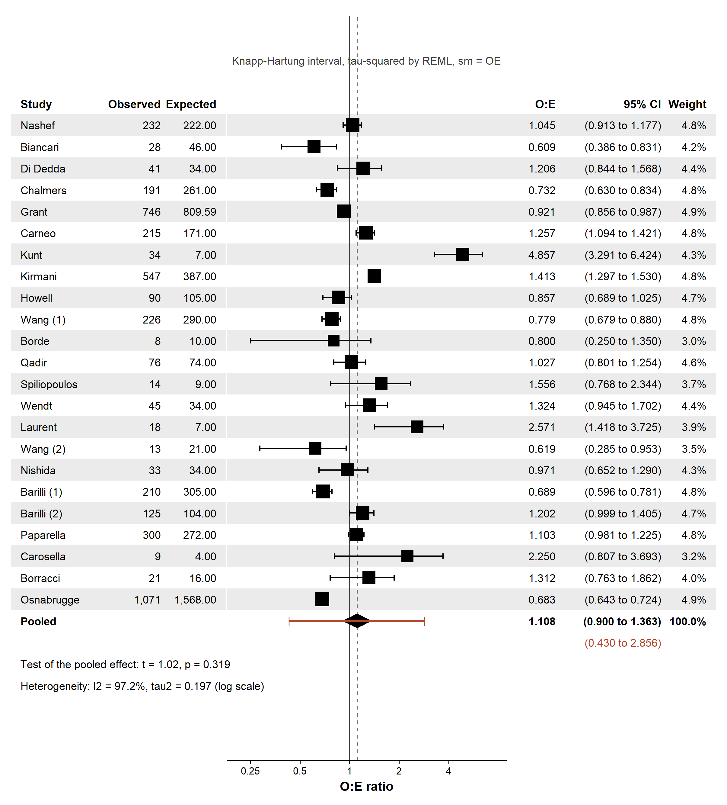
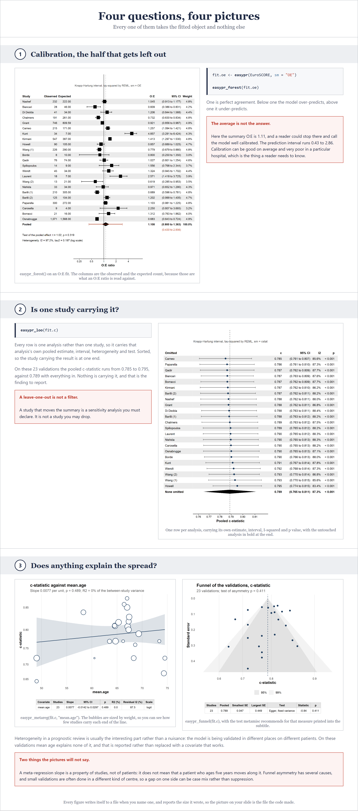
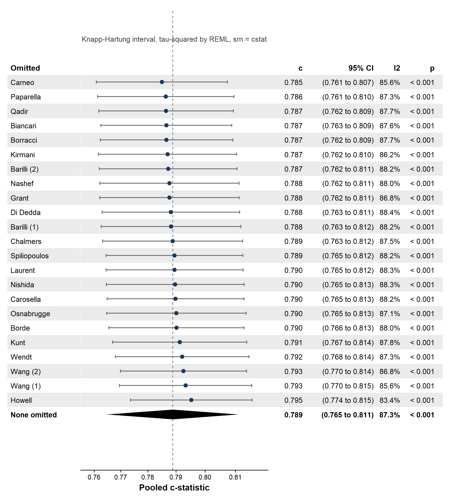
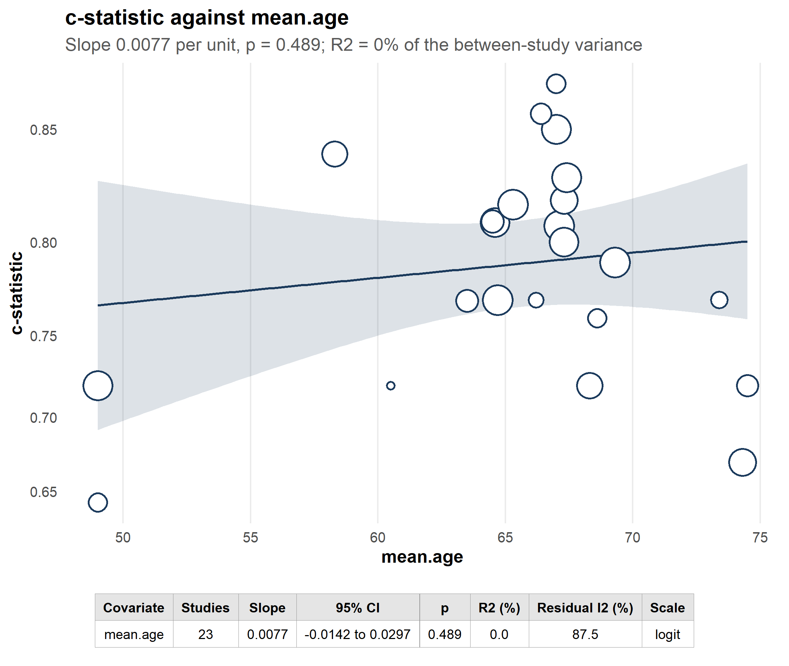
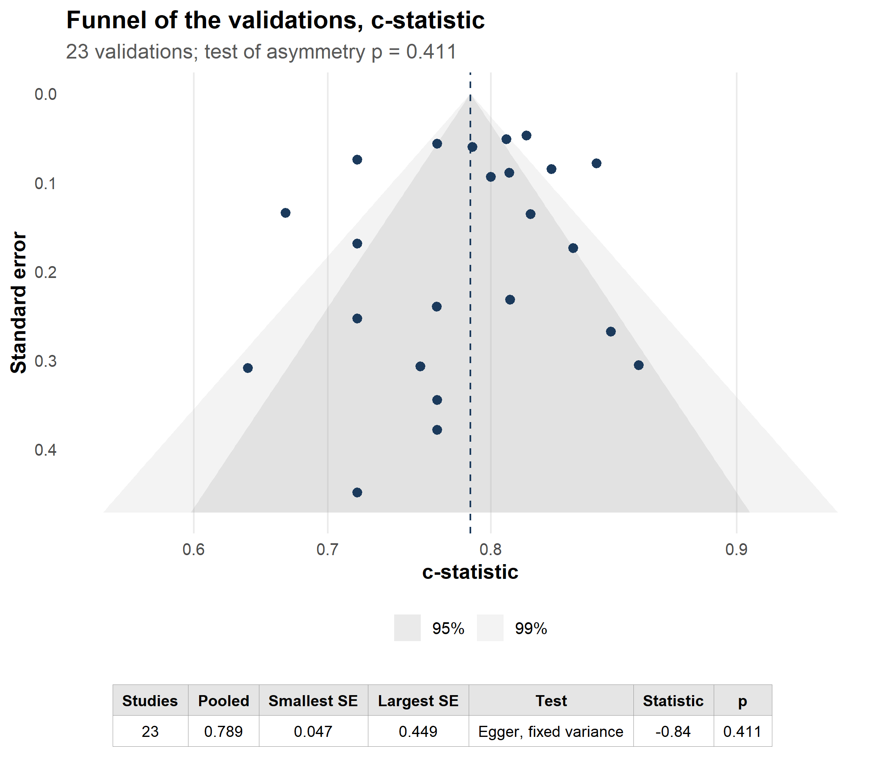

# easyPR

**Prognostic meta-analysis in one call, argued the way the `meta` package
argues. The book that teaches it is free.**

Sponsored by [Meta-Analysis Academy](https://metaanalysisacademy.com).

The book in this repository teaches prognostic meta-analysis end to end, and
it is free to read: **[open the book](https://vanioljantunes.github.io/easyPR/)**.
Its source is in [`book/`](book) as Quarto files. The R package that the book
teaches is in [`R/`](R), in the same repository, so the text and the code
cannot drift apart.

## Contents

| Section | What it covers |
|:---|:---|
| **[1 . Install it, and what it does](#1-install-it-and-what-it-does)** | The one entry point, the four functions that take what it returns, and every main argument |
| **[2 . Prepare the data, then fit it](#2-prepare-the-data-then-fit-it)** | One row per study, whatever each paper reported, then `easypr()` |
| **[3 . The forest, and the interval that matters](#3-the-forest-and-the-interval-that-matters)** | `easypr_forest()`, the columns `sm` chooses, and why the prediction interval is the one to quote |
| **[4 . A model, not a factor](#4-a-model-not-a-factor)** | Discrimination and calibration, and why a review needs both |
| **[5 . Leave one out](#5-leave-one-out)** | Whether one study is carrying the pooled result |
| **[6 . Meta-regression](#6-meta-regression)** | `easypr_metareg()`, and what a study-level covariate can and cannot tell you |
| **[7 . Small-study effects](#7-small-study-effects)** | `easypr_funnel()`, and why asymmetry is read differently here |

<sub>[References](#references) . [Licence](#licence)</sub>

---

## 1. Install it, and what it does



A **prognostic meta-analysis** does not pool a treatment effect. It asks one
of two questions, and the second has two halves: what does this **factor** do
to risk, and does this **model** work when somebody else runs it on their own
patients. A model that works has to rank patients correctly and also quote
risks that happen.

You install it from GitHub, and you need nothing else.

<details>
<summary><b>Install easyPR</b>: <code>{r install}</code></summary>

```r
# Paste the whole block into R.
# install.packages("remotes")
remotes::install_github("vanioljantunes/easyPR")

library(easyPR)
```

</details>

There is one entry point, `easypr()`, and four functions that take what it
returns. You will recognise the arguments if you have used **{meta}**: `sm`,
`studlab`, `method`, `method.tau`, `level` and `common` mean here what they
mean there. You write `sm = "HR"` where another package would ask you to log
the ratio, recover its standard error from the interval, and remember which
scale you were on.

| Function | What it answers | Main arguments |
|:---|:---|:---|
| `easypr()` | What is the pooled result? | `data`, `sm`, `studlab`, `method`, `method.tau`, `method.ci`, `level`, `common` |
| `easypr_forest()` | What did each study contribute? | `x`, `label.e`, `label.c`, `direction`, `order`, `columns`, `prediction`, `xlim`, `digits` |
| `easypr_loo()` | Is one study carrying it? | `x`, `order`, `xlab`, `result` |
| `easypr_metareg()` | Does a study covariate explain the spread? | `x`, `moderator`, `main`, `result` |
| `easypr_funnel()` | Are the small studies different? | `x`, `main`, `xlab`, `result` |



`sm` takes five values. Three of them pool a prognostic factor and two pool a
model's performance.

| `sm` | The question it answers | Pooled on |
|:---|:---|:---|
| `"HR"`, `"OR"`, `"RR"` | How much does this factor shift risk? | log, read back as a ratio |
| `"cstat"` | Does the model rank patients correctly? | logit, read back as a c-statistic |
| `"OE"` | Are the risks it quotes the risks that happen? | log, read back as a ratio |

Estimation is delegated to **{metamisc}** (Debray and de Jong) and
**{metafor}** (Viechtbauer), which easyPR calls and never second-guesses.
`method = "Inverse"` is the only pooling available, because these measures
reach easyPR as an estimate and a standard error. Naming another one is an
error rather than a silently ignored argument.

## 2. Prepare the data, then fit it



One row per study for a factor, one row per validation for a model. What each
row needs is whatever that paper happened to report: the ratio with a
confidence interval, or with a standard error, or neither, leaving the counts
to work back from.

You do not have to rename your columns first. easyPR recognises the common
spellings and says what it decided they meant.

<details>
<summary><b>Pool a prognostic factor</b>: <code>{r factor}</code></summary>

```r
data(Zhang, package = "metamisc")

fit <- easypr(data = Zhang, method.tau = "REML", sm = "HR",
              method = "Inverse")
fit
```

</details>

```
easypr: read HR as effect, HR.025 as effect.cilb, HR.975 as effect.ciub.

Pooled hazard ratio across 20 studies
Pooling: inverse variance, random effects, REML, Knapp-Hartung interval.

  HR                  2.013
  95% confidence      1.591 to 2.547
  95% prediction      1.106 to 3.665
  tau-squared         0.081  (log scale)
  I-squared           42.9%
  test of effect      t = 6.23, p < 0.001
```

Nothing is pooled on the scale it was reported on. A ratio is pooled on the
log scale, which is where it is symmetric, and read on the ratio scale, which
is where you live. `tau-squared` is labelled with the scale it belongs to,
because it is a variance on the pooling scale and never travels back with the
effect.

`method.ci` decides how the interval around the pooled estimate is built.
The default, `"t"`, is the Knapp-Hartung adjustment, which the prognosis
handbook recommends and which matters most when there are few studies.
`method.ci = "z"` gives the normal interval instead.

`summary(fit)` adds the table of studies, with each one's weight.

## 3. The forest, and the interval that matters

<details>
<summary><b>Draw it</b>: <code>{r forest}</code></summary>

```r
easypr_forest(fit,
              label.e = "High expression", label.c = "Low expression",
              direction = "bad", xlab = "Overall survival")
```

</details>



The columns beside the effect are not a style choice. They follow `sm`,
because they are the quantities that measure is read against: a factor shows
the sample size, a c-statistic shows the size and the events, an O:E ratio
shows the observed and the expected count. A column your table does not carry
is dropped rather than printed as a row of blanks.

`label.e` and `label.c` name the two groups. They head the columns beside
the study label and they name the two sides of the axis, and `direction`
decides which side is which: `"bad"`, the usual case in prognosis, means a
ratio above one favours the second group.

Over the scale sits the line saying how the interval was built, how the
between-study variance was estimated, and what is being pooled. Under the
pooled row sit the test of that pooled effect and the heterogeneity, in that
order.

The confidence interval is about the **average** effect across the studies
that happened. The prediction interval is what the **next** study should
expect, and it is the one a reader of a prognostic review actually needs. It
is written in red under the pooled interval, because a summary without it
describes the studies you found rather than the patient in front of you.

## 4. A model, not a factor

The same function, a different `sm`. A review of a prediction model has to
report both halves of its performance, and they can disagree.

<details>
<summary><b>Discrimination, then calibration</b>: <code>{r model}</code></summary>

```r
data(EuroSCORE, package = "metamisc")

fit.c  <- easypr(EuroSCORE, sm = "cstat")
fit.oe <- easypr(EuroSCORE, sm = "OE")

easypr_forest(fit.c)
easypr_forest(fit.oe)
```

</details>



On these 23 EuroSCORE II validations the summary c-statistic is 0.789, 95 per
cent confidence 0.765 to 0.811, and the prediction interval is 0.679 to
0.868. The second is roughly three times the width of the first, which is the
honest summary: discrimination is not settled, and where the model is
validated next matters about as much as the model does.



Calibration is the half most often left out. One is perfect agreement, below
one the model over-predicts, above one it under-predicts. The summary O:E is
1.11, which on its own reads as a well calibrated model. The prediction
interval runs 0.43 to 2.86.

A model can rank patients perfectly and still quote risks that are twice what
happens. A review that reports only the c-statistic has quietly left out
whether the numbers mean anything.



## 5. Leave one out

<details>
<summary><b>Refit without each study</b>: <code>{r loo}</code></summary>

```r
easypr_loo(fit.c)
```

</details>



Every row is one analysis rather than one study, so it carries that
analysis's own pooled estimate, interval, heterogeneity and test. The last
row, in bold, is the analysis with nothing left out, which is what the others
are read against. Here the pooled c-statistic runs from 0.785 to 0.795
against 0.789 with everything in, so nothing is carrying it.

A leave-one-out that moves the summary is a sensitivity analysis you must
declare. It is not a study you may drop.

## 6. Meta-regression

<details>
<summary><b>One study-level covariate</b>: <code>{r metareg}</code></summary>

```r
easypr_metareg(fit.c, "mean.age")
```

</details>



Heterogeneity here is usually the interesting part rather than a nuisance.
The model is being validated in different places on different patients, and
the question is whether that explains the spread. On these validations mean
age explains none of it, and easyPR reports that rather than inviting you to
try covariates until one works.

The bubble plot is the honest way to show a regression, because you can see
how few studies are carrying each end of the line. The covariate is a
property of the study, so a slope says that studies differ. It does not say
that moving a patient along that covariate would move their risk.

## 7. Small-study effects

<details>
<summary><b>Funnel and the asymmetry test</b>: <code>{r funnel}</code></summary>

```r
easypr_funnel(fit.c)
```

</details>



Asymmetry is read with more care here than in a treatment review. Small
validations are not only more variable, they are often done in a different
kind of centre, so a gap on one side can be case mix rather than suppression.
easyPR runs the test metamisc recommends for the measure, reports it, and
says plainly when there are too few studies for it to carry weight.

## References

Debray TPA, de Jong VMT. *metamisc: Meta-Analysis of Diagnosis and Prognosis
Research Studies*. R package.

Debray TPA, Damen JAAG, Snell KIE, et al. A guide to systematic review and
meta-analysis of prediction model performance. *BMJ* 2017;356:i6460.

Riley RD, Ensor J, Snell KIE, et al. External validation of clinical
prediction models using big datasets. *BMJ* 2016;353:i3140.

Viechtbauer W. Conducting meta-analyses in R with the metafor package.
*Journal of Statistical Software* 2010;36(3):1-48.

## Licence

GPL-2 for the package code. CC BY-NC-SA 4.0 for the book text, see
`LICENSE-text.md`.

## Related

Part of the MetaRank 4 catalog from the [Meta-Analysis
Academy](https://metahub.metaanalysisacademy.com): one design, taught end to
end, per repo. The book is free. The video course, templates and support are
the paid half.

- [easyDR](https://github.com/vanioljantunes/easyDR), dose-response
- [easyGWA](https://github.com/vanioljantunes/easyGWA), genetic
