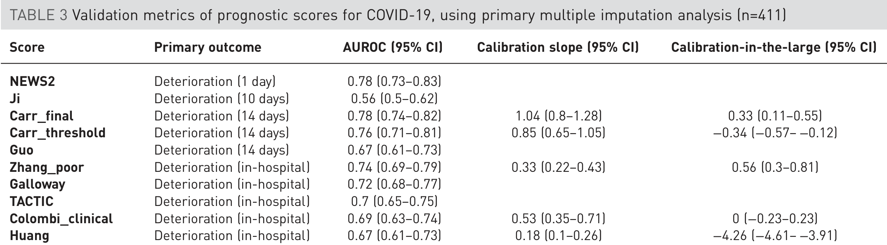
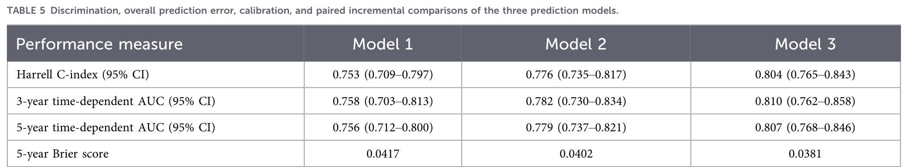
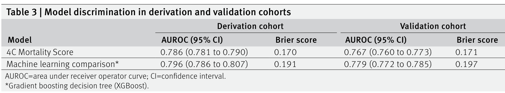
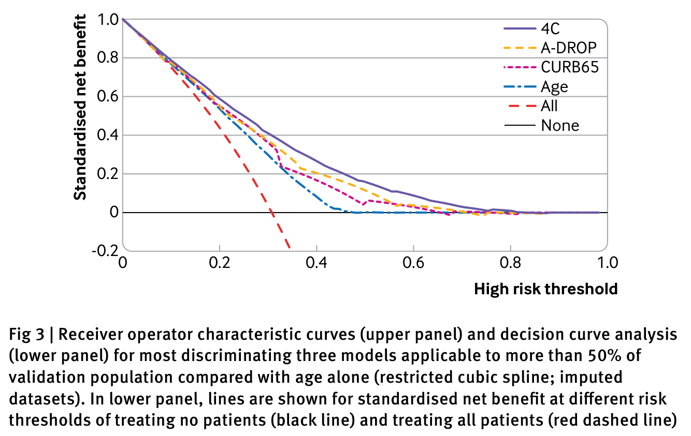
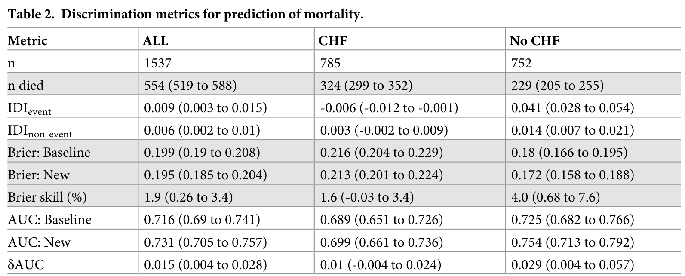
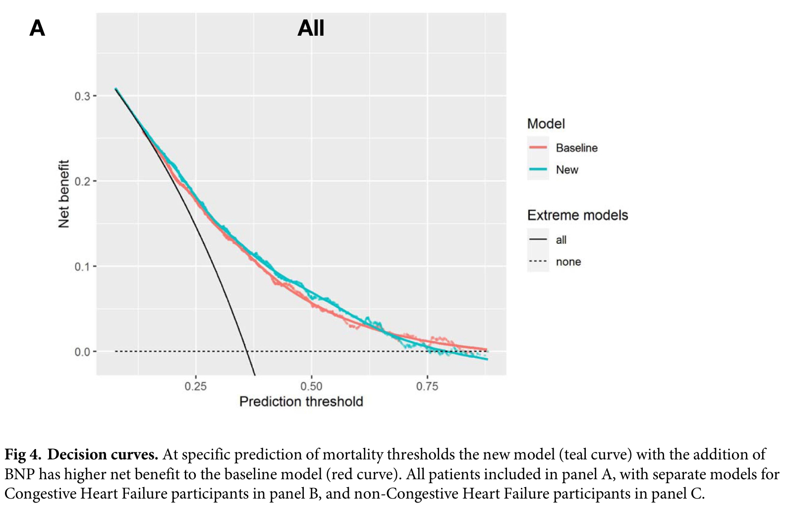
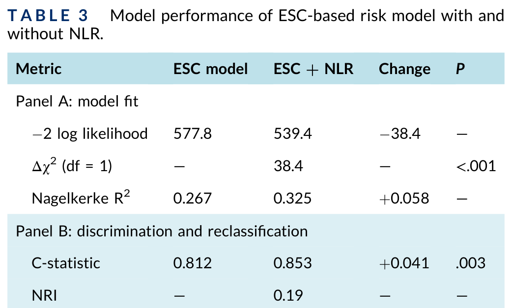
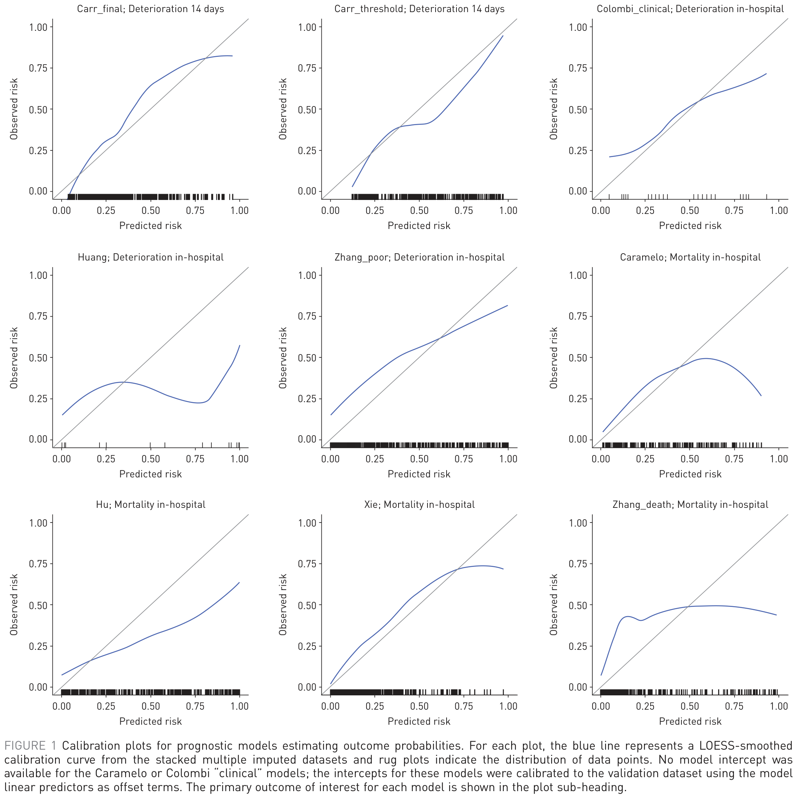

# Viability, search strategy and data extraction

::: {.callout-warning}
Draft. The section structure below is fixed and matches class 4.3 of the
Meta-Analysis Academy sequence. The prose is being written.
:::

## What this chapter covers

Placeholder. One H2 is one slide, so this structure is also the deck outline,
and every section carries its own figure the way easyDR chapter 1 does.

## What to extract from a prediction-model study

A prognostic factor study hands us one number per study, usually a hazard
ratio. A prediction-model study hands us many, and they answer different
questions. Some ask whether the risks the model quotes are the risks that
happen (**calibration**). Others ask whether it ranks patients correctly
(**discrimination**), or whether the model is worth using at all (**clinical
utility**). A last group asks how much a new predictor adds to a model that
already exists (**incremental value**).

Let us list every measure we may meet in a validation paper, together with a
real study that reports it. The extraction sheet needs one column pair for each
measure the included studies report: the estimate and its 95% confidence
interval, or its standard error when the interval is missing.

```{r}
#| label: tbl-pm-measures
#| echo: false
#| tbl-cap: "Performance measures of a prediction model, and a published study that reports each one."
knitr::kable(data.frame(
  Measure = c(
    "Observed-to-expected ratio (O:E)",
    "Calibration-in-the-large (CITL)",
    "Calibration slope",
    "c-statistic, area under the ROC curve",
    "Harrell's c-index",
    "Time-dependent AUC, c(t)",
    "Royston's D",
    "Explained variation (R-squared)",
    "Brier score",
    "Net benefit",
    "Change in c-statistic",
    "Change in net benefit",
    "Change in R-squared"),
  `What it asks` = c(
    "Total observed events over total predicted events. 1 is right.",
    "Is the average predicted risk right? 0 is right.",
    "Is the spread of predicted risks right? 1 is right; below 1, too extreme.",
    "Does a patient with the outcome get a higher risk than one without?",
    "The c-statistic for time-to-event outcomes, with censoring.",
    "Discrimination at a fixed time point, such as 5 years.",
    "Separation of prognosis between patients, on a log hazard ratio scale.",
    "Share of outcome variation the model explains: Cox-Snell, Nagelkerke, Royston's R-squared D.",
    "Mean squared gap between predicted risk and outcome. Lower is better.",
    "True positives gained minus false positives paid for, at a risk threshold.",
    "Discrimination added by a new predictor.",
    "Clinical utility added by a new predictor.",
    "Explained variation added by a new predictor."),
  `Real example` = c(
    "EuroSCORE II validations [@guida2014]",
    "Gupta, Table 3 [@gupta2020]",
    "Gupta, Table 3 [@gupta2020]",
    "Gupta, Table 3 [@gupta2020]",
    "QRISK3, Supplementary Table 6 [@hippisleycox2017]",
    "Hu, Table 5 [@hu2026]",
    "QRISK3, Supplementary Table 6 [@hippisleycox2017]",
    "QRISK3 (Royston); Hashim, Table 3 (Nagelkerke) [@hashim2026]",
    "4C Mortality Score, Table 3 [@knight2020]",
    "4C Mortality Score, Figure 3 [@knight2020]",
    "Pickering, Table 2 [@pickering2022]",
    "Pickering, Figure 4A [@pickering2022]",
    "Hashim, Table 3 [@hashim2026]"),
  check.names = FALSE))
```

The three calibration measures usually travel together, and the table by
@gupta2020 is a good place to see them side by side. We see each model's
AUROC, its calibration slope and its calibration-in-the-large in one row. The
Huang model, for example, has a slope of 0.18 and a calibration-in-the-large
of -4.26: it separates patients reasonably, and the risks it quotes are far
too extreme and far too high.

{#fig-gupta-table3}

Three details decide whether a number can enter the meta-analysis later, so
they belong on the extraction sheet as well.

* **The type of validation.** Apparent performance in the development data is
  optimistic, and internal validation (bootstrap, cross-validation, split
  sample) only partly corrects for it [@collins2024]. Record which one each
  number comes from, and pool external validations only.
* **The model that was validated.** A recalibrated or extended model is not
  the original one [@debray2017]. Record whether the authors changed the
  intercept, the coefficients or the predictors before reporting performance.
* **The formulation.** R-squared comes in several versions that are not on the
  same scale, and net benefit depends on the threshold. Record which version
  and which thresholds each study used.

::: {.callout-note collapse="true"}
## More real examples, one per measure

![Supplementary Table 6 of QRISK3 [@hippisleycox2017]: Royston's D, Harrell's c and Royston's R-squared by age group.](figures/metrics/qrisk3-stable6.png)














:::


