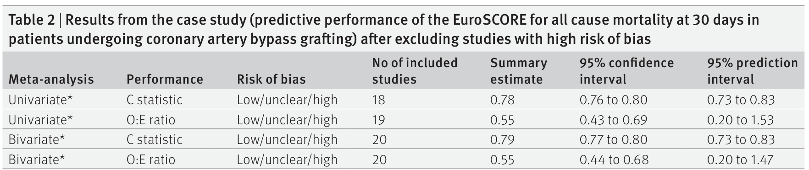
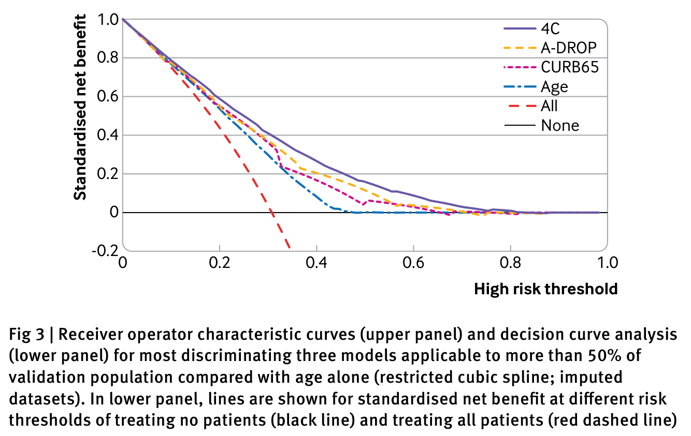

# Statistics theory and code

What the model is doing, in enough detail to defend it in review, and then the
same analysis run end to end on published data you can download.

::: {.callout-warning}
Draft. The section structure below is fixed and matches the class; the prose is
being written.

Every `##` section gets its own figure, as in Chapter 1. One H2 is one slide, so
the figure is also that slide's visual, and a section without one leaves the
deck with a blank.
:::

Theory first, then the code that fits it. The two were separate classes until
2026-10-20; they are one now, because nobody defends a model they have not run
and nobody trusts a fit they cannot explain. The code sections follow the same
order as the theory, so each fit lands next to the reason for it.

```{r}
#| include: false
suppressMessages(library(easyPR))
knitr::opts_chunk$set(collapse = FALSE, comment = "", fig.align = "center")
# Measured, not guessed: the output column fits 69 monospace characters at
# this font size. Never let CSS wrap this text: alignment is the information.
options(width = 66)
```

## What this chapter covers

Placeholder. One H2 is one slide, so this structure is also the deck outline,
and every section carries its own figure the way easyDR chapter 1 does.

## Which performance measures can be pooled

In Chapter 2 we met thirteen measures a prediction-model study may report.
Only some of them can be pooled, and the reason is rarely a lack of numbers. A
measure can be pooled when it means the same thing in every study and has a
scale on which its between-study distribution is roughly normal. When either
condition fails, the honest summary is a table, not a diamond.

```{r}
#| label: tbl-pool-map
#| echo: false
#| tbl-cap: "What to do with each performance measure of a prediction model in a meta-analysis."
knitr::kable(data.frame(
  Measure = c(
    "c-statistic, AUROC, Harrell's c",
    "Time-dependent AUC, c(t)",
    "O:E ratio",
    "Calibration-in-the-large",
    "Calibration slope",
    "Royston's D",
    "Brier score",
    "R-squared (any version)",
    "Change in c, change in R-squared",
    "Net benefit, change in net benefit",
    "Hosmer-Lemeshow test, NRI, sensitivity and specificity at one cut-off"),
  Decision = c(
    "Pool",
    "Pool, one time point at a time",
    "Pool",
    "Pool, together with the slope",
    "Pool, together with O:E or CITL",
    "Pool with care",
    "Report in a table",
    "Pool with care, one version only",
    "Pool with care",
    "Do not pool by inverse variance",
    "Do not pool"),
  Scale = c(
    "logit", "logit", "log", "as reported", "as reported", "as reported",
    "", "as reported", "as reported", "", ""),
  `easyPR call` = c(
    'sm = "cstat"', 'sm = "cstat"', 'sm = "OE"', 'sm = "citl"',
    'sm = "slope"', "", "", "", "", "", ""),
  check.names = FALSE))
```

We see three groups. The first five rows are the core of every review of a
prediction model, and **{easyPR}** pools each of them. Royston's D, R-squared
and the incremental measures can be pooled only when every study reports the
same version against the same reference model, which in practice is rare. The
last rows are reported, never pooled, and the last section of this chapter
explains why.

## Seven rules for pooling a model's performance

Debray and colleagues wrote the guide most reviews of prediction models now
follow [@debray2017], and the rules below come from that guide and from the
papers it builds on. Each one closes a door that published reviews have walked
through.

1. **Never pool one calibration measure alone.** Report the O:E ratio or the
   calibration-in-the-large, the calibration slope, and the calibration plots
   [@riley2024]. A model can have an O:E ratio of 1 and still be useless, with
   risks too high for some patients and too low for others.
2. **Pool on the right scale.** The c-statistic goes on the logit scale and
   the O:E ratio on the log scale, which is where their between-study
   distributions are closest to normal [@snell2018]. The calibration slope and
   the calibration-in-the-large are pooled as reported.
3. **Always report the prediction interval.** For EuroSCORE II the summary
   O:E ratio is 1.11, and its 95% prediction interval runs from 0.43 to 2.85
   [@debray2019]. The average is reassuring; the next hospital is not.
4. **Discrimination and calibration are linked.** In the data of Snell and
   colleagues the c-statistic and the calibration slope were positively
   correlated within studies [@snell2016]. When the data allow it, the two are
   modelled together; the next sections show what that means for published
   data.
5. **Net benefit is not pooled by inverse variance.** Wynants and colleagues
   proposed a Bayesian trivariate random-effects meta-analysis of sensitivity,
   specificity and prevalence, repeated at each threshold [@wynants2018].
6. **Never mix versions of R-squared.** Cox-Snell, Nagelkerke and Royston's
   R-squared D are on different scales, so a pooled "R-squared" across them
   has no meaning.
7. **Never mix development with validation, or one model with another.**
   Apparent performance is optimistic [@collins2024], and a recalibrated model
   is a new model. Pool external validations of the same, unchanged model
   [@debray2017].

Two tools are missing from this list on purpose. The Hosmer-Lemeshow test
should not be used to assess calibration [@riley2024; @vancalster2019], and
net reclassification indices are not recommended for evaluating a model
[@kerr2014].

## Pooling the calibration slope and calibration-in-the-large

Time to put what we learned into practice. Our data come from the individual
participant data meta-analysis of covid-19 mortality models by de Jong and
colleagues [@dejong2022]. Their supplement reports, for every hospital or
country, the c-statistic, the calibration slope, the calibration-in-the-large
and the O:E ratio, each with its 95% confidence interval. That is rare, and it
is why the data ship with **{easyPR}** as `dejong`.

Let us take the model by Xie and colleagues, validated in nine clusters.

```{r}
xie <- subset(dejong, model == "Xie")
easypr.object.slope <- easypr(xie, sm = "slope")
easypr.object.slope
```

We see that the pooled calibration slope is 0.45, with a 95% confidence
interval from 0.27 to 0.63. A slope well below 1 means the predicted risks are
too extreme: too high for patients at high risk and too low for those at low
risk. The prediction interval reaches from -0.08 to 0.98, so not one new
setting should expect a slope of 1. The printout also reminds us of rule 1.

```{r}
#| label: fig-forest-slope
#| fig-cap: "Calibration slope of the Xie model across nine validations [@dejong2022]. The reference line at 1 is a model whose spread of risks is right."
#| fig-width: 10
#| fig-height: 5.5
easypr_forest(easypr.object.slope)
```

The calibration-in-the-large is the other half of the picture.

```{r}
easypr.object.citl <- easypr(xie, sm = "citl")
easypr.object.citl
```

The pooled calibration-in-the-large is -0.10, close to 0, so on average the
model predicts about as many deaths as occur. Yet the prediction interval runs
from -2.94 to 2.75, and $I^2$ is 99%. The average hides settings where the model
predicts far too many deaths and settings where it predicts far too few.

## Discrimination and calibration together: a table of findings

Rule 4 says that the c-statistic and the calibration measures of a model are
linked. A **bivariate meta-analysis** models them jointly, and it can answer a
question that two separate analyses cannot: how likely is the model to perform
well on **both** counts in a new setting? With individual participant data,
Snell and colleagues estimated this joint probability for a c-statistic above
0.70 and a calibration slope between 0.9 and 1.1 [@snell2016].

Published studies make this much harder. The joint model needs the
correlation between the two estimates within each study, which no paper
reports, and most validations do not report the slope at all. In their guide,
Debray and colleagues fitted a bivariate model of the c-statistic and the O:E
ratio from published EuroSCORE validations, assumed a within-study correlation
of zero, and reported the result as rows of a table [@debray2017].

{#fig-debray-table2}

We see that the bivariate rows barely move the summaries: the c-statistic goes
from 0.78 to 0.79 and the O:E ratio stays at 0.55. When a review works from
published data, the recommended output is therefore a **table of findings**:
one row per measure, each pooled on its own scale, with its confidence and
prediction intervals, read together. Let us build one for the Xie model.

```{r}
measures <- c(cstat = "c-statistic",
              OE    = "O:E ratio",
              citl  = "Calibration-in-the-large",
              slope = "Calibration slope")
row <- function(sm) {
  r <- suppressMessages(easypr(xie, sm = sm))
  b <- easyPR:::pr_bwd(r$scale)
  f <- function(v) formatC(b(v), format = "f", digits = 2)
  data.frame(Measure = measures[[sm]], k = r$k,
             Summary = f(r$estimate),
             `95% CI` = paste(f(r$ci.lb), "to", f(r$ci.ub)),
             `95% PI` = paste(f(r$pi.lb), "to", f(r$pi.ub)),
             I2 = paste0(round(r$I2), "%"), check.names = FALSE)
}
findings <- do.call(rbind, lapply(names(measures), row))
knitr::kable(findings, row.names = FALSE)
```

We see the whole model in four lines. It discriminates moderately well, with a
c-statistic of 0.75, and on average it predicts the right number of deaths.
Yet its slope of 0.45 says the risks it quotes are too extreme, and the wide
prediction intervals of all three calibration measures say that how well it
is calibrated depends on where it is used. No single pooled number would have
told us that.

## What is reported but not pooled

Some measures stay out of the pooling, and the table of findings carries them
as text instead.

**Net benefit** answers the question a clinician actually has: does using the
model to decide treatment do more good than harm at the threshold where I would
act? It is read off a **decision curve**, one per study, and it depends on the
threshold and on how common the outcome is in that setting. Pooling it needs
the trivariate model of Wynants and colleagues at each threshold
[@wynants2018], so a review working from published data shows the decision
curves of the included studies and describes them.

{#fig-knight-nb}

The **Brier score** mixes calibration and discrimination and also depends on
the outcome incidence, so it goes in the table study by study. The
**Hosmer-Lemeshow test** gives a p-value that depends mostly on sample size,
and it should not be used to judge calibration [@vancalster2019]. Net
reclassification indices are not recommended [@kerr2014], and sensitivity and
specificity at a single cut-off such as 0.5 discard the very thing a risk model
provides, a risk [@riley2024]. When a study reports only these, record them,
and say in the review that they could not be pooled.


